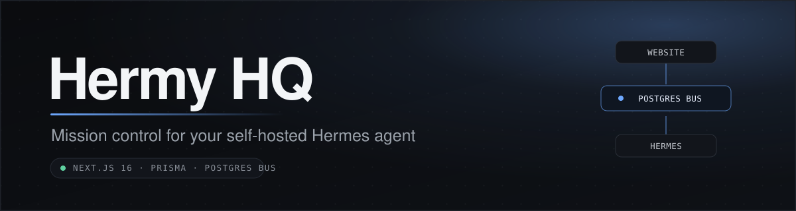
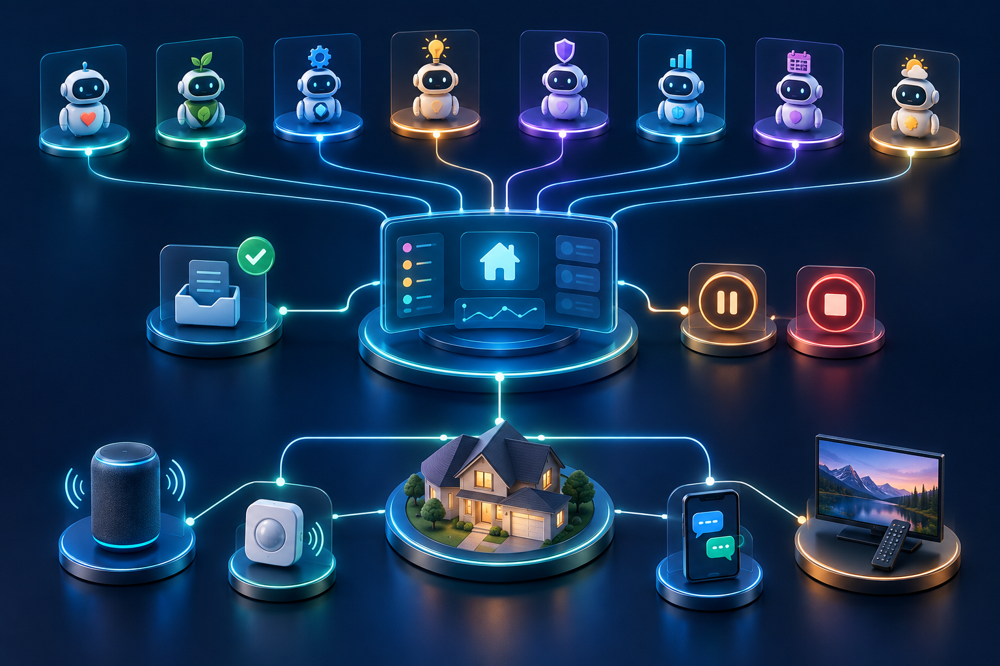
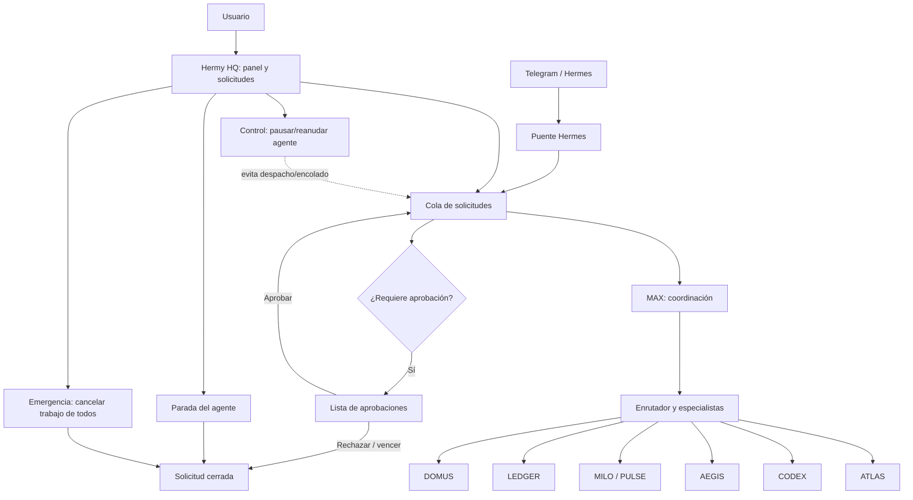

# Hermy HQ personalizado

Banner original del Hermy HQ instalado en este proyecto.

Repositorio público de **Hermy HQ personalizado**, panel de coordinación de ocho roles de agentes integrado con Hermes Agent mediante un Bridge. Contiene un **snapshot filtrado** de fuentes, migraciones, dependencias y ejemplos, no una reproducción íntegra del runtime o los datos del VPS. Excluye bases de datos, credenciales, registros, compilaciones, archivos privados y respaldos.

Este proyecto se integra con [Hermes Agent Personalized](https://github.com/Reynaldo8509/hermes-agent-personalized) y [Home Assistant Personalized](https://github.com/Reynaldo8509/home-assistant-personalized).

## Mapa visual de la integración

La ilustración resume visualmente el ecosistema. El diagrama Mermaid y las secciones siguientes describen los flujos implementados con etiquetas precisas.

## Funciones que muestra el proyecto

- Panel de agentes con estado, actividad y controles individuales de pausa/reanudación.
- Control de parada de un agente y control de emergencia para cancelar trabajo activo global.
- Flujo de solicitudes y aprobaciones con estados pendientes, aprobadas, rechazadas y vencidas.
- Puente Hermes que coloca solicitudes, asigna especialistas, evita encolar seguimiento para agentes pausados y conserva historial de solicitudes.
- Agent Bus y cola persistente para solicitudes, asignación y seguimiento entre el dashboard, Bridge y workers.
- Action Center para revisión de aprobaciones; scheduler y routing sujetos a políticas, permisos y disponibilidad.
- Observabilidad con vistas de actividad, historial, tareas, costes, salud, memoria y aprobaciones; las métricas reales no se reconciliaron en la auditoría.

## Agentes configurados

| Agente | Función configurada |
|---|---|
| **MAX** | Orquestación, clasificación y coordinación |
| **ATLAS** | Investigación y validación de evidencia |
| **CODEX** | Ingeniería y ejecución delegada desde HQ; no es el Codex CLI de la Dell |
| **AEGIS** | Ciberseguridad con acciones deterministas y alcance de lectura |
| **LEDGER** | Respaldos y continuidad operativa |
| **MILO** | Correo y clasificación; su timer estaba inactivo en el corte auditado |
| **DOMUS** | Integración con Home Assistant y domótica |
| **PULSE** | Redes sociales y YouTube; ruta/modelo parcial en el corte auditado |

El catálogo y las capacidades están sujetos a la configuración y a los permisos. La presencia de un agente no demuestra ejecución E2E.

## Auditoría y alcance funcional (20 de noviembre de 2026)

En la inspección se encontraron ocho agentes configurados: **MAX, ATLAS, CODEX, AEGIS, LEDGER, MILO, DOMUS y PULSE**. La presencia de cada agente en el catálogo **no equivale a ejecución E2E demostrada**. MAX coordina; los especialistas ejecutan funciones diferenciadas sujetas a políticas, routing, disponibilidad y autorizaciones.

El Bridge y el proceso HQ se observaron activos. La validación final registrada para el snapshot público tuvo **293 pruebas aprobadas, 0 fallidas y 1 omitida**; la omitida requiere un unit file privado. El health autenticado de la API HQ y la ejecución E2E individual de los agentes no se certificaron. `AUTOAPPROVAL_ENABLED=false` desactiva la aprobación delegada general; existe además una ruta separada de operador firmado Ed25519 con capacidades acotadas, cuyo ciclo E2E no se validó. La ruta MAX de notificación automática está bloqueada hasta disponer de un handler Bridge dedicado.

- **[Inventario de los ocho agentes y estado de HQ](docs/AGENTS-STATUS-2026-11-20.md)**: roles, componentes, arquitectura y evidencias.
- **[Contrato de solicitudes de reinicio MCP](docs/MCP-RESTART-APPROVAL.md)**: alcance del código, controles y estado de validación; su publicación no implica que esté desplegado.
- **[Inventario técnico de Hermes personalizado](https://github.com/Reynaldo8509/hermes-agent-personalized/blob/main/docs/CAPABILITIES-2026-11-20.md)**.
- Los módulos públicos de HQ y Bridge están organizados en este repositorio; el documento de agentes identifica qué componentes se observaron y cuáles siguen sin validación E2E.

## Diagrama

## Ejecución de una tarea

1. Una solicitud entra desde el panel, Telegram o un observador programado.
2. El puente determina la categoría, aplica el estado de pausa y agrega una solicitud a la cola.
3. MAX puede coordinar y delegar trabajo especializado; las rutas se registran en la cola.
4. Las tareas con efectos laterales esperan aprobación antes de ejecutarse. La interfaz permite revisar, aprobar o rechazar. Las aprobaciones pendientes caducan según la política del servidor.
5. El panel actualiza estado y conserva los resultados en la base de datos de producción, que no se publica.

Las acciones concretas, categorías y estados se definen en `hermes-bridge/bridge.mjs`, `src/app/api/agents/control/route.ts`, `src/app/api/hermes/approvals/route.ts` y `src/app/agents/page.tsx`. La parada de emergencia cierra solicitudes activas y termina workers registrados; no es un apagado del VPS.

## Instalación y configuración

Ejecuta `./install.sh` tras crear `.env` en privado. Consulta `ONBOARDING.md` y `package.json` para requisitos. Prepara PostgreSQL, copia `.env.example` como `.env` y completa sus marcadores localmente, aplica las migraciones Prisma y ejecuta el servidor Next.js según el script de producción. Configura el puente Hermes como proceso de servicio separado tras revisar `deploy/systemd/`. No reutilices una base de datos real ni secretos del despliegue publicado.

## Privacidad

No se publican tokens, `.env`, bases de datos, historiales, contenido generado privado, mensajes de Telegram, claves, logs ni archivos de respaldo. Los ejemplos deben completarse localmente.
