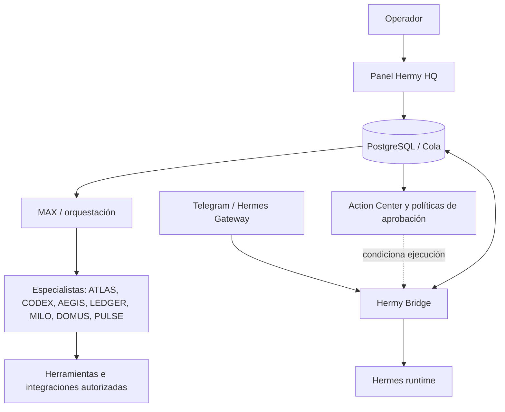

# Hermy HQ personalizado: agentes, módulos y estado de auditoría

**Corte:** 20 de noviembre de 2026 · **Fuente:** auditoría de código, servicios y pruebas seleccionadas ejecutada desde la Dell G15 sobre el VPS. **No supone una validación de extremo a extremo de los ocho agentes.**

Hermy HQ es el panel y plano de coordinación utilizado con [Hermes Agent personalizado](https://github.com/Reynaldo8509/hermes-agent-personalized). Integra una interfaz Next.js, un Bridge de ejecución y persistencia PostgreSQL/Prisma, además de componentes de control, tareas, memoria y políticas. Las funciones configuradas son distintas de las efectivamente comprobadas durante esta inspección.

## Componentes

| Área | Elementos en el código o configuración | Alcance de la comprobación |
|---|---|---|
| Panel | Agentes, tareas, memoria, operaciones, salud, métricas, YouTube y Action Center | Componentes y módulos encontrados; no se certificó funcionamiento E2E de cada página |
| Bridge | Despacho, registro de incidentes, selección de modelos, supervisor, scheduler y workers | Proceso observado activo; suite offline seleccionada aprobada |
| Persistencia | PostgreSQL/Prisma, migraciones y almacenes auxiliares | Estructura presente; sin ejecutar migraciones ni leer datos privados |
| Aprobaciones | Cola, estados, políticas de autorización y contratos de operaciones con efectos externos | Módulos presentes; ciclo completo de aprobación no probado |
| Routing | Políticas de privacidad, modelo local y proveedores gratuitos configurados | No se ejecutaron inferencias comerciales ni se validaron todos los proveedores |
| Identidad de nodos | La asociación Tailscale usa alias de despliegue por `INFRA_NODE_HOST_ALIASES_JSON`; los valores no se publican en el repositorio | Requiere configuración local del entorno; no se comprobó la presencia del valor en producción |
| CODEX | Worker separado del Codex CLI de Dell y VPS | Servicio activo; no se despachó trabajo durante la auditoría |

## Ocho agentes configurados

| Agente | Responsabilidad definida | Evidencia y límite al corte |
|---|---|---|
| **MAX** | Orquestación, clasificación de solicitudes y coordinación | Código de coordinación y proceso HQ presentes; disponibilidad funcional individual no verificada |
| **ATLAS** | Investigación, obtención y validación de evidencia | Rutas gratuitas, política y tests presentes; sin navegación externa en esta auditoría |
| **CODEX** | Ingeniería y ejecución delegada desde HQ | Worker dedicado con ruta de modelo definida; no confundir con el Codex CLI principal de Dell |
| **AEGIS** | Seguridad y auditoría con restricciones de lectura | Adaptadores deterministas presentes; no se ejecutaron pruebas ofensivas |
| **LEDGER** | Backups, continuidad y registros operativos | Última tarea de backup terminó con exit 0; restauración no comprobada |
| **MILO** | Correo y clasificación | Módulos presentes; timer de correo deshabilitado al corte |
| **DOMUS** | Home Assistant y domótica | Integraciones y lectura determinista en código; sin acción real sobre dispositivos |
| **PULSE** | Redes sociales y YouTube | Contratos/routing presentes; ruta o modelo no disponible según la inspección |

**No se afirma que los ocho agentes hayan superado aceptación E2E.** El catálogo puede evolucionar y las capacidades están sujetas a permisos, rutas de ejecución y servicios efectivos.

## Arquitectura lógica

Diagrama conceptual de los componentes encontrados; **no certifica cada trayecto, autorización, identidad o llamada de producción**.

## Funcionalidades destacadas en el snapshot de código

- Solicitudes, cola, estados, control de agentes y cancelación.
- Action Center, auditoría de aprobaciones y políticas de operaciones con efectos externos.
- Políticas y módulos de aislamiento de contexto, privacidad y selección de modelos.
- Herramientas de investigación/documentación de ATLAS.
- Diagnóstico, telemetría, detección de incidentes y monitorización de disponibilidad.
- Integraciones preparadas con correo, domótica, YouTube y Job-Apply.
- Contratos específicos para Codex y controles de ejecución.
- Componentes de interfaz para tareas, agentes, memoria y operaciones.

La presencia de un módulo no garantiza que esté activado. `AUTOAPPROVAL_ENABLED=false` desactiva la aprobación delegada general. Hay una ruta distinta de operador firmado Ed25519 que puede autoaprobar operaciones incluidas en su allowlist y registro de identidad; no queda cubierta por esa variable y su ciclo E2E no se comprobó. La categoría `max.owner_notification` está bloqueada hasta implementar y validar un handler Bridge dedicado.

## Resultados y limitaciones de validación

- **293 pruebas aprobadas, 0 fallidas y 1 omitida** en la validación final registrada para el snapshot público. La prueba omitida necesita el unit file privado de despliegue; lint terminó sin errores (70 avisos), type-check y build fueron revisados en la auditoría final.
- Proceso HQ y Bridge observados activos, pero **no se confirmó de forma independiente el health autenticado de la API HQ**.
- No se probó la ejecución E2E de cada agente, envío externo, ciclo de aprobación completo ni continuidad tras reinicios.
- La funcionalidad del modelo local y de los proveedores configurados no quedó demostrada por inferencia durante esta auditoría.
- El correo MILO estaba inactivo, PULSE tenía una ruta no disponible y la restauración de backup estaba pendiente.
- La versión del manifiesto de HQ figura como `0.1.0`, que no debe interpretarse como certificación de una versión comercial estable.

## Estado de publicación

El **PR #2** de sincronización del 20 de noviembre de 2026 se fusionó en `main` el 21 de noviembre de 2026 mediante squash; el commit de merge es `6d6f3d22874175c0b73b5e78e494a59d4490932a`. Incorporó **242 archivos nuevos/modificados** seleccionados de HQ y Bridge. Excluye identidad, datos de runtime, credenciales, unidades de despliegue, archivos privados y material que requiere sanitización adicional. No implica paridad completa con la producción del VPS.

**Licencias y atribuciones:** distinguir los componentes originales, dependencias de terceros y personalizaciones de REY. No usar esta documentación como promesa de disponibilidad ni de controles de seguridad certificados.

## Repositorios relacionados

- [Hermes Agent Personalized](https://github.com/Reynaldo8509/hermes-agent-personalized)
- [Home Assistant Personalized](https://github.com/Reynaldo8509/home-assistant-personalized)
- [Política de seguridad](../SECURITY.md)

La publicación es un snapshot público sanitizado, no una copia de las bases de datos ni de la configuración completa del servidor.
